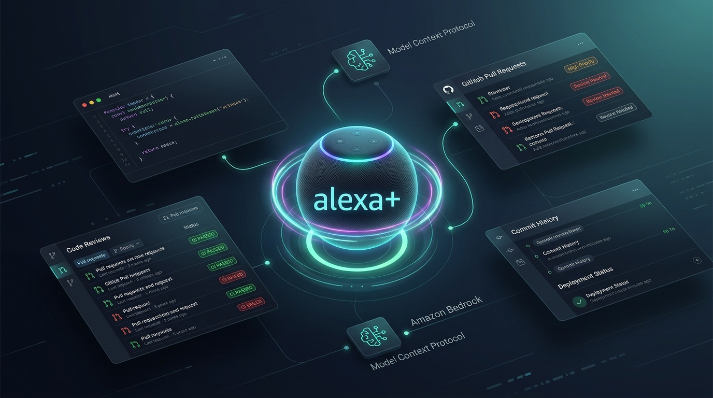
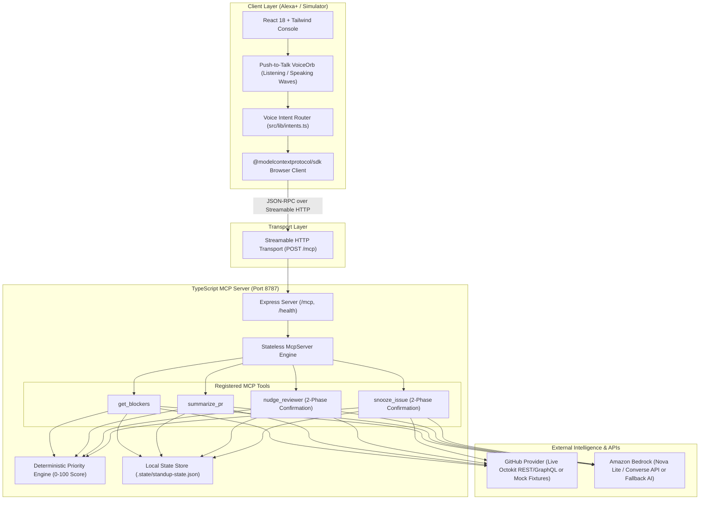

<div align="center">

# 🎙️ Standup Chief of Staff
### The Voice-First Developer Chief of Staff for Alexa+ powered by MCP & Amazon Bedrock

[-orange?style=for-the-badge&logo=amazon)](https://developer.amazon.com)
[-00f0ff?style=for-the-badge)](https://modelcontextprotocol.io)
[-teal?style=for-the-badge&logo=amazonaws)](https://aws.amazon.com/bedrock/)
[](https://www.typescriptlang.org)
[](https://vitest.dev)

<br/>



<br/><br/>

> **"Alexa, what's blocking me today?"**  
> Hear a 30-second spoken briefing synthesized from your GitHub pull requests, failing CI builds, stale reviews, and high-priority issues, then act immediately by voice:  
> *"Nudge Priya on that review"* &nbsp;•&nbsp; *"Snooze issue 42 until Friday"*

[**Quickstart (60s Demo)**](#-60-second-instant-quickstart-offline-demo) • [**System Architecture**](#-system-architecture) • [**MCP Tools**](#-mcp-tool-contracts) • [**Demo Script**](#-90-second-demo-storyline) • [**Live Mode Guide**](#-enabling-live-github--amazon-bedrock)

</div>

---

## ⚡ The Vision: Beyond Chatbots to Actionable Voice MCP

Engineers waste up to 45 minutes every morning context-switching across GitHub notifications, Slack threads, and failing CI pipelines just to answer: *"What is actually blocking me from shipping code today?"*

**Standup Chief of Staff** turns **Alexa+** into an executive engineering chief of staff:
1. **Intelligent Aggregation**: Ingests active work across multiple repositories via GitHub REST and GraphQL.
2. **Deterministic Priority Scoring**: Evaluates items against an objective 0–100 urgency algorithm (failing CI, stale PR reviews, merge conflicts, overdue assignees, blocking teammates).
3. **Bedrock AI Reasoning**: Leverages **Amazon Bedrock (Nova Lite via Converse API)** to re-rank blockers and generate a natural 30-second spoken briefing suitable for audio playback.
4. **Voice-Driven Action with Two-Phase Confirmation**: Developers take real action by voice (*"Nudge Priya"*, *"Snooze 42"*). The server generates safe preview tokens with 5-minute TTL before committing writes.
5. **100% Offline Capability**: Runs seamlessly offline in mock mode with zero credentials for reliable demos and development.

---

## 🏛️ System Architecture

The architecture pairs a **real MCP Client** in the simulated Alexa+ console with a **stateless TypeScript MCP Server** over **Streamable HTTP**.



---

## ⚡ 60-Second Instant Quickstart (Offline Demo)

Experience the entire voice flow instantly with bundled mock fixtures—**zero API keys, zero AWS credentials, zero configuration required**.

### 1. Clone & Install
```bash
git clone https://github.com/zeeshansaeed6/standup-chief-of-staff.git
cd standup-chief-of-staff
npm run install:all
```

### 2. Launch Demo Mode
```bash
npm run demo
```

Open your browser at **[http://localhost:5173](http://localhost:5173)**.

### 3. Interact by Voice, Click, or Keyboard
- 🎙️ **Push-to-Talk**: Click and hold the glowing central **VoiceOrb**, or simply **hold Spacebar** anywhere to speak.
- ⚡ **Quick Chips**: Click *"What's blocking me?"*, *"Summarize PR 128"*, *"Nudge Priya on 128"*, or *"Snooze issue 42 until Friday"*.
- 💬 **Typed Commands**: Type commands directly in the conversation console.

---

## 🎬 90-Second Demo Storyline

| Step | Voice / Action | Assistant Spoken Response | Visual Result |
| :---: | :--- | :--- | :--- |
| **1** | *"Alexa, what's blocking me today?"* | *"Good morning! You have 5 key items today. First, PR 128, Refactor auth token refresh, needs attention because stale review waiting on Priya Sharma for 28 hours... Want me to nudge Priya?"* | Renders ranked cards with priority scores, CI status icons, and age chips. |
| **2** | *"Summarize PR 128"* | *"Pull request 128 touches 3 files with plus 278 and minus 92 lines. Risk level is medium. Awaiting review from priya-sharma."* | **PrSummaryCard** renders file diff statistics, risk rating, and blocking factors. |
| **3** | *"Nudge Priya on that review"* | *"I'll nudge Priya on pull request 128 with this message: 'Hi @Priya, when you have a moment, could you please take a look at PR #128?'. Should I send it?"* | **ActionConfirmModal** opens with AI-drafted message preview and voice prompts. |
| **4** | *"Yes, send it"* (or Confirm button) | *"I've simulated the nudge to Priya on pull request 128."* | Confirmation token consumed, audit log updated. |
| **5** | *"Snooze issue 42 until Friday"* ➔ *"Confirm"* | *"Issue 42 is now snoozed until Friday. It won't appear in your daily briefing until then."* | **Issue #42 instantly vanishes** from the ranked blockers board! |
| **6** | Inspect EventLog | Real-time JSON-RPC inspector | Live view of all MCP tool calls, latency in milliseconds, and raw responses. |

---

## 🛠️ MCP Tool Contracts

The server exposes 4 tools and 1 resource conforming to the official Model Context Protocol specifications:

| Tool Name | Parameters | Capabilities & Guarantees |
| :--- | :--- | :--- |
| `get_blockers` | `repos?: string[]`<br/>`limit?: number`<br/>`includeSnoozed?: boolean` | Analyzes all assigned work, runs deterministic scoring, sends top candidates to Bedrock for ranking refinement, and returns structured JSON + conversational spoken audio. |
| `summarize_pr` | `repo: string`<br/>`number: number` | Deeply analyzes PR file additions/deletions, CI commit status rollups, and comments to classify merge risk (`low`/`medium`/`high`) and suggest actionable next steps. |
| `nudge_reviewer` | `repo: string`<br/>`number: number`<br/>`reviewer: string`<br/>`tone?: string`<br/>`confirm?: boolean`<br/>`confirmationId?: string` | **Two-Phase Confirmation**: Previews Bedrock-drafted reminder message and returns a 5-minute confirmation token. Only mutates state upon `confirm: true`. |
| `snooze_issue` | `repo: string`<br/>`issueNumber: number`<br/>`until: string`<br/>`confirm?: boolean`<br/>`confirmationId?: string` | **Natural Date Parsing**: Accepts natural expressions (`friday`, `tomorrow`, `next week`) or ISO timestamps. Excludes issue from subsequent `get_blockers` queries. |
| Resource: `standup://status` | *None* | Read-only diagnostic resource reporting MCP server health, active data/AI modes, monitored repositories, and active snooze counts. |

---

## 🔌 Enabling Live GitHub & Amazon Bedrock

You can seamlessly connect real cloud services using `.env`:

```bash
cp .env.example .env
```

### 1. Live GitHub Integration
```ini
DATA_MODE=live
GITHUB_TOKEN=ghp_yourPersonalAccessTokenHere
GITHUB_USER=your_github_username
GITHUB_REPOS=owner/repo1,owner/repo2
LIVE_WRITES=false   # Safe simulation; set true to post real PR comments
```
- Authenticates using GitHub Personal Access Token (classic or fine-grained with `repo` scope).
- Employs GraphQL to fetch statusCheckRollup (CI state) and review decisions in a single query.

### 2. Live Amazon Bedrock Integration
```ini
BEDROCK_MODE=live
AWS_REGION=us-east-1           # Or eu-north-1, us-west-2, etc.
AWS_ACCESS_KEY_ID=AKIA...
AWS_SECRET_ACCESS_KEY=...
BEDROCK_MODEL_ID=us.amazon.nova-lite-v1:0
```
- Calls the Amazon Bedrock **Converse API (`ConverseCommand`)** using Amazon Nova Lite.
- **Graceful Zero-Crash Fallback**: If AWS credentials or account verification are pending, the server automatically degrades to the built-in conversational template engine with a visible warning badge in the UI.

---

## 📁 Repository Structure

```
standup-chief-of-staff/
├── package.json                    # Monorepo configuration (npm workspaces)
├── tsconfig.base.json              # Shared TypeScript base configuration
├── .env.example                    # Documented environment variable template
├── docs/
│   ├── assets/hero-banner.png      # Project visual banner
│   ├── ARCHITECTURE.md             # Detailed architecture diagrams & data flows
│   ├── ALEXA_PLUS.md               # Technical Alexa+ registration guide
│   └── DEMO_SCRIPT.md              # 90-second step-by-step hackathon script
├── packages/
│   └── shared/                     # Shared Zod schemas & types (@standup/shared)
│       └── src/index.ts
├── apps/
│   ├── server/                     # TypeScript MCP Server (@standup/server)
│   │   ├── src/
│   │   │   ├── index.ts            # Express server, /mcp Streamable HTTP endpoint
│   │   │   ├── mcp/                # McpServer & tool registrations
│   │   │   ├── github/             # Live Octokit & Mock fixture providers
│   │   │   ├── bedrock/            # Bedrock Converse API & fallback templates
│   │   │   ├── scoring/            # Deterministic 0-100 priority scoring engine
│   │   │   └── store/              # LocalStateStore for snoozes & confirmations
│   │   └── test/                   # Vitest unit & integration test suite
│   └── web/                        # Alexa+ Web Simulator (@standup/web)
│       └── src/
│           ├── components/         # VoiceOrb, BriefingCard, ConfirmModal, EventLog
│           ├── hooks/              # useMcp, useSpeechRecognition, useSpeechSynthesis
│           └── lib/intents.ts      # Pure voice intent router
└── scripts/
    └── smoke.ts                    # Automated end-to-end MCP protocol smoke test
```

---

## 🧪 Testing & Quality Assurance

The codebase enforces strict test coverage across all workspaces:

```bash
# 1. Run all 33 Vitest unit & integration tests
npm test

# 2. Run end-to-end MCP Streamable HTTP protocol smoke test
npm run smoke

# 3. Compile all packages with strict TypeScript checks
npm run build
```

---

## 🛡️ Security & Privacy Guardrails

- **Zero Secrets Committed**: All `.env` and credential files are strictly ignored by Git. Only `.env.example` is tracked.
- **Simulated Writes Default**: `LIVE_WRITES=false` guarantees that nudging colleagues or snoozing issues never alters production GitHub repositories unless explicitly enabled.
- **Two-Phase Confirmation**: High-impact actions require explicit voice or button confirmation, preventing unintended writes.
- **Expiring Confirmation Tokens**: Action tokens expire after 5 minutes to prevent stale operations.

---

## 🏆 Built for the Amazon Developer Hackathon

This entire project was conceived, architected, and built from scratch during the hackathon window. It showcases how the **Model Context Protocol (MCP)** and **Amazon Bedrock** can turn **Alexa+** into an indispensable tool for developer productivity.

---

## 📄 License

MIT License. See [LICENSE](LICENSE) for details.
