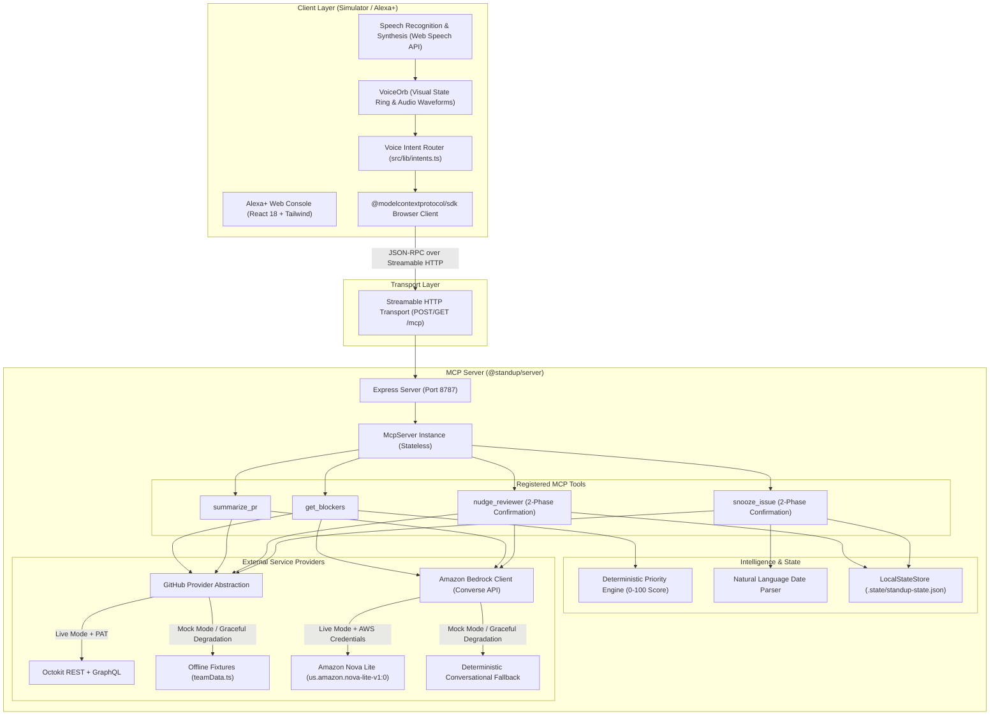
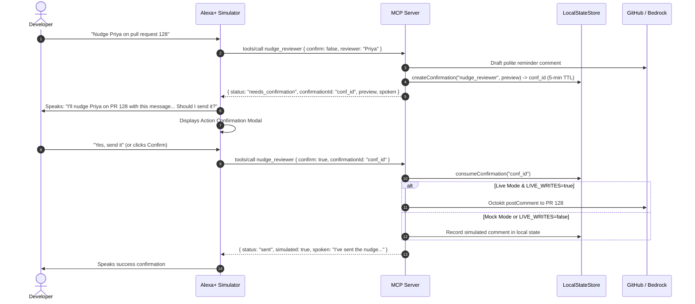

# System Architecture: Standup Chief of Staff

Standup Chief of Staff is a voice-first Developer Chief of Staff built on the **Model Context Protocol (MCP)** over Streamable HTTP. It allows developers to converse naturally with Alexa+ to hear a 30-second spoken briefing of their daily blockers (failing CI, stale PR reviews, merge conflicts, overdue issues) and take instantaneous voice action ("nudge Priya on that review", "snooze issue 42 until Friday").

---

## 1. High-Level Architecture Diagram

---

## 2. End-to-End Data Flow

### Flow A: Daily Standup Spoken Briefing (`get_blockers`)
1. **Utterance**: Developer speaks *"Alexa, what's blocking me today?"*
2. **Intent Parsing**: `intents.ts` extracts intent `get_blockers` with arguments `{ limit: 5 }`.
3. **MCP Call**: The MCP Client initiates a `tools/call` request over Streamable HTTP to `/mcp`.
4. **Data Aggregation**: `GitHubProvider` gathers assigned pull requests, review requests, and open issues across configured repositories (`acme/payments-platform`, `acme/web-dashboard`).
5. **Deterministic Priority Scoring**:
   - Failing CI build: **+30 points**
   - Stale review requested from developer (> 24h): **+25 points** (scaled up to +35 by age)
   - Changes requested on developer's PR: **+25 points**
   - P0/Blocker issue: **+25 points**
   - Developer's PR approved but unmerged: **+10 points**
   - Merge conflicts: **+15 points**
   - Assigned and overdue: **+15 points**
   - Team blocked waiting on developer: **+20 points**
   - Snoozed items: **filtered out** until expiry.
6. **Bedrock AI Processing**:
   - **Task A (Ranking)**: Bedrock re-evaluates top candidates and produces strict JSON `{ ranked, oneLineSummary }`.
   - **Task B (Conversational Briefing)**: Bedrock generates a natural 20-30 second spoken briefing (under 90 words, no markdown or URLs, conversational audio phrasing).
7. **Dual-Content Response**:
   - The MCP tool returns both structured JSON and a spoken string.
   - Alexa+ synthesizes the spoken briefing and renders ranked priority cards in the web console.

---

### Flow B: Two-Phase Confirmation (`nudge_reviewer` & `snooze_issue`)
To guarantee safety and transparency, all write actions enforce a two-phase confirmation lifecycle:

---

## 3. Resilience & Graceful Degradation
- **Zero-Crash Architecture**: Missing credentials or network failures never throw unhandled 500s.
- If `DATA_MODE=live` is configured without `GITHUB_TOKEN`, the server automatically degrades to offline mock fixtures and surfaces a `degraded` flag in health and tool results.
- If `BEDROCK_MODE=live` is configured without AWS credentials or hits rate limits, it automatically falls back to deterministic conversational templates and surfaces a visible amber badge in the UI.
